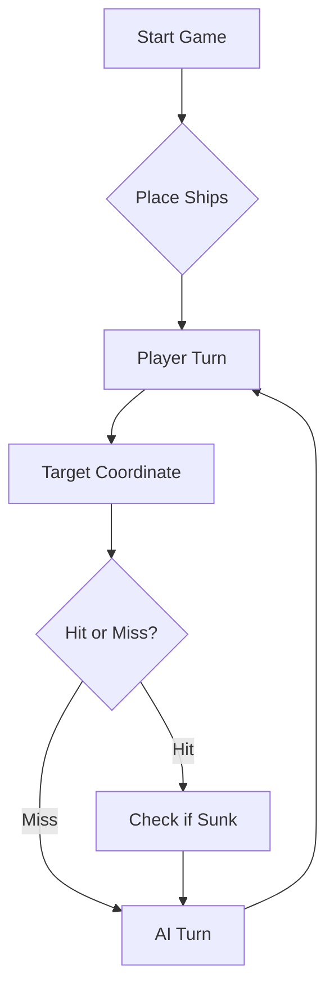

# Battleship2 - Ficha 2 de Engenharia de Software

## Protocolo de comunicação com o LLM (Parte C)

A rajada é enviada em JSON:

```json
[ {"row": "A", "column": 5}, {"row": "C", "column": 10}, {"row": "F", "column": 5} ]
```

A resposta é gerada pelo programa (`Move.processEnemyFire`) e impressa na consola depois de cada rajada:

```json
{
  "validShots" : 3,
  "sunkBoats" : [ {"count" : 1, "type" : "Barca"} ],
  "repeatedShots" : 0,
  "outsideShots" : 0,
  "hitsOnBoats" : [ {"hits" : 1, "type" : "Nau"} ],
  "missedShots" : 1
}
```

---

## Prompt final da estratégia (Parte D)

```
Considere agora a seguinte tática de geração de rajadas de tiros.

1. Diário de Bordo: registe cada rajada numerada (Rajada 1, 2, 3...) com as coordenadas
   exatas de cada tiro e o resultado que eu lhe devolvo em JSON. Antes de cada nova rajada
   mostre-me o diário resumido e um mapa 10x10 com: X = tiro em navio, o = água,
   # = navio afundado, ? = tiro de uma rajada ambígua (ainda não sabe se acertou),
   - = água garantida (não disparar), . = ainda não testado.

2. Nunca dispare fora do tabuleiro (linhas A-J, colunas 1-10) nem repita coordenadas já
   testadas ou marcadas com "-". A única exceção é a última rajada, só para completar os
   3 tiros quando a minha frota já estiver toda afundada.

3. ATENÇÃO, a resposta é agregada: o JSON diz QUANTOS tiros acertaram e em que TIPO de
   navio, mas não diz QUAL dos 3 tiros acertou. Se uma rajada tiver acertos e águas,
   marque os 3 tiros com "?" e mantenha uma lista de hipóteses ("se o acerto foi em G7,
   então..."). Para as resolver use estas regras:
   a) Os navios não se tocam: uma casa encostada (mesmo na diagonal) a uma casa de navio
      ou é do MESMO navio ou é água. Se G7 foi água e G8 deu Fragata, a Nau não está em G7.
   b) Se só falta 1 navio de um tipo, qualquer acerto nesse tipo pertence a esse navio.
   c) Uma casa rodeada de água só pode ser uma Barca; uma casa com um só vizinho livre
      define a orientação do navio.
   d) Na rajada seguinte, cada tiro deve testar UMA só hipótese (casas vizinhas de um só
      candidato), para que o resultado diga qual delas era verdadeira.
   e) Descarte as hipóteses que contradizem qualquer JSON anterior.

4. Modo caça vs. modo alvo:
   - Se houver algum navio atingido e ainda não afundado ("hitsOnBoats"), está em MODO ALVO:
     dispare nas posições contíguas (Norte, Sul, Este, Oeste) do tiro certeiro. Depois de 2
     tiros certeiros alinhados, continue só nessa linha/coluna, nas duas pontas.
   - Se não houver navios atingidos por afundar, está em MODO CAÇA: dispare em padrão de
     xadrez (casas onde linha+coluna é par), espalhando os 3 tiros por zonas diferentes
     do tabuleiro e longe das casas "-". Quando só faltarem Barcas, o xadrez já não ajuda:
     dispare nas casas livres que ainda não estão em nenhum halo.

5. Como Caravelas, Naus e Fragatas são linhas retas e os navios não se tocam, as diagonais
   de um tiro certeiro são água garantida. Exceção: o Galeão (forma de T) - se o "type"
   for "Galeao", as asas da ponte ficam na diagonal do corpo.

6. Navios afundados:
   - Um navio afundado aparece SÓ em "sunkBoats" e nunca em "hitsOnBoats", nem os tiros
     que lhe acertaram nessa mesma rajada. Ex.: dois tiros que acabam um Galeão dão
     "sunkBoats":[{"count":1,"type":"Galeao"}] e "hitsOnBoats":[].
   - Se na mesma rajada afundar um navio e acertar noutro do MESMO tipo, esse segundo
     acerto NÃO aparece no JSON (fica escondido). Por isso, depois de um afundamento,
     confirme que não ficou nenhum navio desse tipo tocado.
   - Se acertar num tipo e o acerto anterior nesse tipo estiver encostado, mas o JSON não
     disser "ao fundo", então são dois navios diferentes.
   - Use o Diário de Bordo para descobrir que tiros pertencem ao navio afundado (o número
     de tiros tem de ser igual ao tamanho: Barca 1, Caravela 2, Nau 3, Fragata 4, Galeão 5)
     e marque todo o halo à volta com "-".

7. Mantenha a contagem da minha frota (4 Barcas, 3 Caravelas, 2 Naus, 1 Fragata,
   1 Galeão) e não procure navios de um tipo que já foi todo afundado.

8. Responda SEMPRE apenas com a rajada em JSON, no formato
   [ {"row": "A", "column": 5}, {"row": "C", "column": 10}, {"row": "F", "column": 5} ]
   seguida do diário resumido.

9. Se a sua frota for toda afundada, declare a derrota com honra. Se for a minha,
   seja um vencedor magnânimo!

Exemplos (few-shot, tirados de um jogo real):

Rajada 3: G7, B4, E9 -> {"validShots":3,"sunkBoats":[],"hitsOnBoats":[{"hits":1,"type":"Nau"}],"missedShots":2,...}
Raciocínio: há uma Nau em G7, B4 ou E9, mas não sei em qual. Marco os 3 com "?".
Rajada 4: G8, B5, D9 (cada tiro encostado a um só candidato) ->
  {"validShots":3,"sunkBoats":[],"hitsOnBoats":[{"hits":1,"type":"Caravela"},{"hits":1,"type":"Fragata"}],"missedShots":1,...}
Raciocínio: uma casa encostada à Nau só pode ser Nau ou água. Como não houve acerto em
Nau, o candidato certo é aquele cujo vizinho deu água; os outros dois vizinhos são a
Caravela e a Fragata, e os candidatos ao lado deles foram água.

Rajada 18: C1, E1, J2 -> {"validShots":3,"sunkBoats":[{"count":1,"type":"Galeao"}],"hitsOnBoats":[],"missedShots":1,...}
Raciocínio: C1 e E1 eram as asas do Galeão (D1, D2, D3 já tinham acertado). Os dois
acertos não aparecem em "hitsOnBoats" porque o navio foi ao fundo; J2 foi água.
```

> Testado num jogo completo contra a frota gerada pelo programa (`gerafrota`): frota toda afundada em 28 rajadas (84 tiros), sem tiros repetidos nem fora do tabuleiro. Os pontos 3 e 6 foram acrescentados depois desse jogo: a maior dificuldade foi a resposta agregada não dizer qual dos tiros acertou.

---

# ⚓ Battleship 2.0


> A modern take on the classic naval warfare game, designed for the XVII century setting with updated software engineering patterns.

---

## 📖 Table of Contents
- [Project Overview](#-project-overview)
- [Key Features](#-key-features)
- [Technical Stack](#-technical-stack)
- [Installation & Setup](#-installation--setup)
- [Code Architecture](#-code-architecture)
- [Roadmap](#-roadmap)
- [Contributing](#-contributing)

---

## 🎯 Project Overview
This project serves as a template and reference for students learning **Object-Oriented Programming (OOP)** and **Software Quality**. It simulates a battleship environment where players must strategically place ships and sink the enemy fleet.

### 🎮 The Rules
The game is played on a grid (typically 10x10). The coordinate system is defined as:

$$(x, y) \in \{0, \dots, 9\} \times \{0, \dots, 9\}$$

Hits are calculated based on the intersection of the shot vector and the ship's bounding box.

---

## ✨ Key Features
| Feature | Description | Status |
| :--- | :--- | :---: |
| **Grid System** | Flexible $N \times N$ board generation. | ✅ |
| **Ship Varieties** | Galleons, Frigates, and Brigantines (XVII Century theme). | ✅ |
| **AI Opponent** | Heuristic-based targeting system. | 🚧 |
| **Network Play** | Socket-based multiplayer. | ❌ |

---

## 🛠 Technical Stack
* **Language:** Java 17
* **Build Tool:** Maven / Gradle
* **Testing:** JUnit 5
* **Logging:** Log4j2

---

## 🚀 Installation & Setup

### Prerequisites
* JDK 17 or higher
* Git

### Step-by-Step
1. **Clone the repository:**
   ```bash
   git clone [https://github.com/britoeabreu/Battleship2.git](https://github.com/britoeabreu/Battleship2.git)
   ```
2. **Navigate to directory:**
   ```bash
   cd Battleship2
   ```
3. **Compile and Run:**
   ```bash
   javac Main.java && java Main
   ```

---

## 📚 Documentation

You can access the generated Javadoc here:

👉 [Battleship2 API Documentation](https://britoeabreu.github.io/Battleship2/)


### Core Logic
```java
public class Ship {
    private String name;
    private int size;
    private boolean isSunk;

    // TODO: Implement damage logic
    public void hit() {
        // Implementation here
    }
}
```

### Design Patterns Used:
- **Strategy Pattern:** For different AI difficulty levels.
- **Observer Pattern:** To update the UI when a ship is hit.
</details>

### Logic Flow


---

## 🗺 Roadmap
- [x] Basic grid implementation
- [x] Ship placement validation
- [ ] Add sound effects (SFX)
- [ ] Implement "Fog of War" mechanic
- [ ] **Multiplayer Integration** (High Priority)

---

## 🧪 Testing
We use high-coverage unit testing to ensure game stability. Run tests using:
```bash
mvn test
```

> [!TIP]
> Use the `-Dtest=ClassName` flag to run specific test suites during development.

---

## 🤝 Contributing
Contributions are what make the open-source community such an amazing place to learn, inspire, and create.

1. Fork the Project
2. Create your Feature Branch (`git checkout -b feature/AmazingFeature`)
3. Commit your Changes (`git commit -m 'Add some AmazingFeature'`)
4. Push to the Branch (`git push origin feature/AmazingFeature`)
5. Open a **Pull Request**

---

## 📄 License
Distributed under the MIT License. See `LICENSE` for more information.

---
**Maintained by:** [@britoeabreu](https://github.com/britoeabreu)  
*Created for the Software Engineering students at ISCTE-IUL.*
