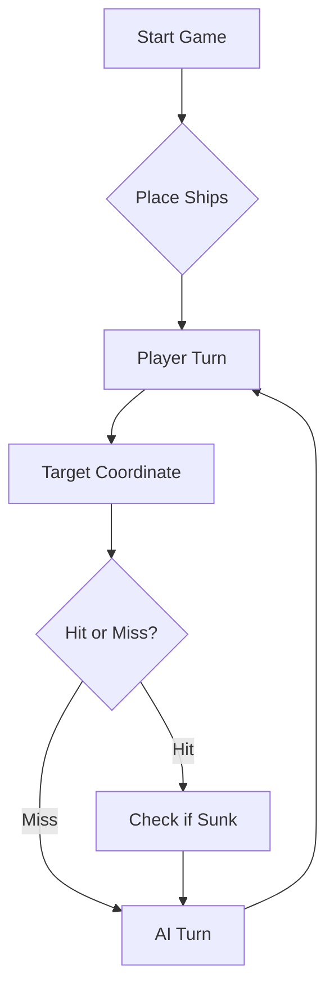

# Battleship2 - Ficha 2 de Engenharia de Software

## Protocolo de comunicação com o LLM (Parte C)

A rajada é enviada em JSON:

```json
[ {"row": "A", "column": 5}, {"row": "C", "column": 10}, {"row": "F", "column": 5} ]
```

A resposta é gerada pelo programa (`Move.processEnemyFire`) e impressa na consola depois de cada rajada:

```json
{
  "validShots" : 3,
  "sunkBoats" : [ {"count" : 1, "type" : "Barca"} ],
  "repeatedShots" : 0,
  "outsideShots" : 0,
  "hitsOnBoats" : [ {"hits" : 1, "type" : "Nau"} ],
  "missedShots" : 1
}
```

---

## Prompt final da estratégia (Parte D)

```
Considere agora a seguinte tática de geração de rajadas de tiros.

1. Diário de Bordo: registe cada rajada numerada (Rajada 1, 2, 3...) com as coordenadas
   exatas de cada tiro e o resultado que eu lhe devolvo em JSON. Antes de cada nova rajada
   mostre-me o diário resumido e um mapa 10x10 com: X = tiro em navio, o = água,
   # = navio afundado, . = ainda não testado, - = água garantida (não disparar).

2. Nunca dispare fora do tabuleiro (linhas A-J, colunas 1-10) nem repita coordenadas já
   testadas ou marcadas com "-". A única exceção é a última rajada, só para completar os
   3 tiros quando a minha frota já estiver toda afundada.

3. Modo caça vs. modo alvo:
   - Se houver algum navio atingido e ainda não afundado ("hitsOnBoats"), está em MODO ALVO:
     dispare nas posições contíguas (Norte, Sul, Este, Oeste) desse tiro. Depois de 2 tiros
     certeiros alinhados, continue só nessa linha/coluna, nas duas pontas.
   - Se não houver navios atingidos por afundar, está em MODO CAÇA: dispare em padrão de
     xadrez (casas onde linha+coluna é par), espalhando os 3 tiros por zonas diferentes
     do tabuleiro. O navio mais pequeno que ainda falta afundar define o espaçamento.

4. Como Caravelas, Naus e Fragatas são linhas retas e os navios não se tocam, as diagonais
   de um tiro certeiro são água garantida. Exceção: o Galeão (forma de T) - se o "type"
   for "Galeao", considere também as posições das asas da ponte.

5. Quando "sunkBoats" indicar um navio afundado, use o Diário de Bordo para descobrir
   quais tiros pertencem a esse navio (o número de tiros tem de ser igual ao tamanho:
   Barca 1, Caravela 2, Nau 3, Fragata 4, Galeão 5) e marque todo o halo à volta com "-".

6. Mantenha a contagem da minha frota (4 Barcas, 3 Caravelas, 2 Naus, 1 Fragata,
   1 Galeão) e não procure navios de um tipo que já foi todo afundado.

7. Responda SEMPRE apenas com a rajada em JSON, no formato
   [ {"row": "A", "column": 5}, {"row": "C", "column": 10}, {"row": "F", "column": 5} ]
   seguida do diário resumido.

8. Se a sua frota for toda afundada, declare a derrota com honra. Se for a minha,
   seja um vencedor magnânimo!

Exemplo (few-shot):
Rajada 5: D4, D5, J9 -> {"validShots":3,"sunkBoats":[{"count":1,"type":"Caravela"}],"hitsOnBoats":[],"missedShots":1,...}
Raciocínio: a Caravela tem 2 posições e só houve 1 tiro na água, logo D4 e D5 eram a
Caravela e J9 foi água. Marco o halo C3, C4, C5, C6, D3, D6, E3, E4, E5, E6 com "-"
e volto ao modo caça.
```

> Nota: este prompt deve ser ajustado com o que aprendermos ao jogar contra o LLM.

---

# ⚓ Battleship 2.0


> A modern take on the classic naval warfare game, designed for the XVII century setting with updated software engineering patterns.

---

## 📖 Table of Contents
- [Project Overview](#-project-overview)
- [Key Features](#-key-features)
- [Technical Stack](#-technical-stack)
- [Installation & Setup](#-installation--setup)
- [Code Architecture](#-code-architecture)
- [Roadmap](#-roadmap)
- [Contributing](#-contributing)

---

## 🎯 Project Overview
This project serves as a template and reference for students learning **Object-Oriented Programming (OOP)** and **Software Quality**. It simulates a battleship environment where players must strategically place ships and sink the enemy fleet.

### 🎮 The Rules
The game is played on a grid (typically 10x10). The coordinate system is defined as:

$$(x, y) \in \{0, \dots, 9\} \times \{0, \dots, 9\}$$

Hits are calculated based on the intersection of the shot vector and the ship's bounding box.

---

## ✨ Key Features
| Feature | Description | Status |
| :--- | :--- | :---: |
| **Grid System** | Flexible $N \times N$ board generation. | ✅ |
| **Ship Varieties** | Galleons, Frigates, and Brigantines (XVII Century theme). | ✅ |
| **AI Opponent** | Heuristic-based targeting system. | 🚧 |
| **Network Play** | Socket-based multiplayer. | ❌ |

---

## 🛠 Technical Stack
* **Language:** Java 17
* **Build Tool:** Maven / Gradle
* **Testing:** JUnit 5
* **Logging:** Log4j2

---

## 🚀 Installation & Setup

### Prerequisites
* JDK 17 or higher
* Git

### Step-by-Step
1. **Clone the repository:**
   ```bash
   git clone [https://github.com/britoeabreu/Battleship2.git](https://github.com/britoeabreu/Battleship2.git)
   ```
2. **Navigate to directory:**
   ```bash
   cd Battleship2
   ```
3. **Compile and Run:**
   ```bash
   javac Main.java && java Main
   ```

---

## 📚 Documentation

You can access the generated Javadoc here:

👉 [Battleship2 API Documentation](https://britoeabreu.github.io/Battleship2/)


### Core Logic
```java
public class Ship {
    private String name;
    private int size;
    private boolean isSunk;

    // TODO: Implement damage logic
    public void hit() {
        // Implementation here
    }
}
```

### Design Patterns Used:
- **Strategy Pattern:** For different AI difficulty levels.
- **Observer Pattern:** To update the UI when a ship is hit.
</details>

### Logic Flow


---

## 🗺 Roadmap
- [x] Basic grid implementation
- [x] Ship placement validation
- [ ] Add sound effects (SFX)
- [ ] Implement "Fog of War" mechanic
- [ ] **Multiplayer Integration** (High Priority)

---

## 🧪 Testing
We use high-coverage unit testing to ensure game stability. Run tests using:
```bash
mvn test
```

> [!TIP]
> Use the `-Dtest=ClassName` flag to run specific test suites during development.

---

## 🤝 Contributing
Contributions are what make the open-source community such an amazing place to learn, inspire, and create.

1. Fork the Project
2. Create your Feature Branch (`git checkout -b feature/AmazingFeature`)
3. Commit your Changes (`git commit -m 'Add some AmazingFeature'`)
4. Push to the Branch (`git push origin feature/AmazingFeature`)
5. Open a **Pull Request**

---

## 📄 License
Distributed under the MIT License. See `LICENSE` for more information.

---
**Maintained by:** [@britoeabreu](https://github.com/britoeabreu)  
*Created for the Software Engineering students at ISCTE-IUL.*
